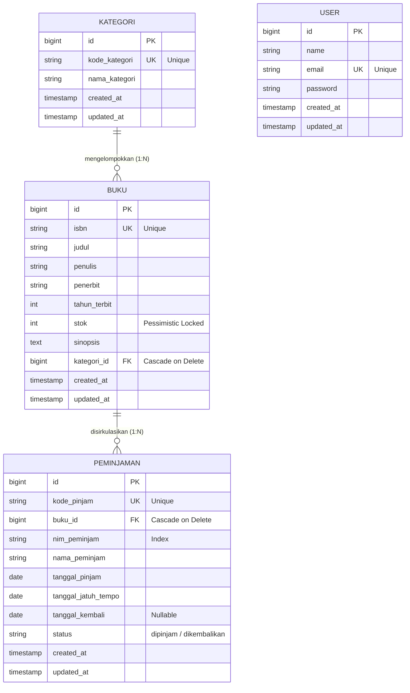

# SIPUS-Del (Sistem Informasi Perpustakaan Kampus Del) — Tahap 2

> **Modul Praktikum Minggu 06 — Pemrograman & Pengujian Web (12S3101)**  
> **Program Studi Sarjana Sistem Informasi / Informatika — Institut Teknologi Del**

---

## Identitas Mahasiswa

| Parameter | Data Mahasiswa |
| :--- | :--- |
| **Nama Lengkap** | Kelvin Yohanes Putra |
| **NIM** | 12S24018 |
| **Program Studi** | Sistem Informasi |
| **Mata Kuliah** | Pemrograman & Pengujian Aplikasi Web (PPW 2026) |

---

## 1. Deskripsi Proyek
**SIPUS-Del Tahap 2** adalah pengembangan lanjutan dari Sistem Informasi Perpustakaan Kampus Del berbasis **Laravel 11.x** dan **MySQL 8.x (InnoDB)**. Proyek ini mengimplementasikan:
1. **Transaksi Basis Data ACID & Concurrency Locking:** Sirkulasi peminjaman dan pengembalian buku dibungkus dalam `DB::transaction()` dengan Pessimistic Locking (`lockForUpdate()`) guna mencegah *Race Condition* stok minus.
2. **Rekapitulasi Fluent Query Builder & withCount:** Kartu ringkasan statistik buku berbasis `DB::table()` dan penghitungan frekuensi peminjaman dengan `withCount('peminjamans')`.
3. **Manajemen Sesi Pengguna & Autentikasi Pustakawan:** Sistem autentikasi aman via `Auth::attempt()`, pencegahan *Session Fixation* via `session()->regenerate()`, pencatatan riwayat sesi, dan penanganan HTTP Cookie `HttpOnly` (`Cookie::queue()`).

---

## 2. Diagram Relasi Entitas (ERD)

Struktur tabel basis data persisten MySQL InnoDB pada SIPUS-Del Tahap 2:



---

## 3. Kredensial Akun Uji Pustakawan (Wajib Modul 6)
Untuk menguji fitur sirkulasi peminjaman, pengelolaan buku, dan kategori yang diproteksi *middleware auth*, gunakan kredensial berikut:

* **URL Login:** `http://127.0.0.1:8000/login`
* **Email:** `pustakawan@del.ac.id`
* **Kata Sandi:** `password123`
* **Hak Akses:** Pustakawan (Full Mutasi Data, Peminjaman, & Pengembalian)

---

## 4. Prasyarat & Lingkungan (Prerequisites)
* PHP 8.2 atau lebih baru (ekstensi `pdo_mysql`, `mbstring`, `openssl` aktif)
* Composer 2.6+
* Database Server: **MySQL 8.x (InnoDB Storage Engine)** via Laragon / MySQL Server

---

## 5. Panduan Instalasi & Menjalankan Proyek

1. **Clone repositori & masuk ke direktori:**
   ```bash
   git clone https://github.com/KelvinMarpaung18/ppw-2026-week5-12S24018.git
   cd ppw-2026-week5-12S24018
   ```

2. **Pasang dependensi Composer:**
   ```bash
   composer install
   ```

3. **Generate Application Key:**
   ```bash
   php artisan key:generate
   ```

4. **Jalankan Migrasi & Seeding Data Uji:**
   ```bash
   php artisan migrate:fresh --seed
   ```
   *(Perintah ini otomatis menginisialisasi akun pustakawan, katalog buku termasuk sampel uji stok 0 & 1, serta riwayat peminjaman).*

5. **Jalankan Server Aplikasi:**
   ```bash
   php artisan serve
   ```
   Akses melalui browser di: **[http://127.0.0.1:8000](http://127.0.0.1:8000)**

---

## 6. Fitur Baru Transaksi ACID & Concurrency Locking

### A. Sirkulasi Peminjaman Buku (`DB::transaction` & `lockForUpdate`)
* Kunci baris buku dengan `lockForUpdate()` agar tidak ada transaksi paralel yang membaca stok usang.
* **Pencegahan Stok Minus (Stok = 0):** Jika stok buku $\le 0$, transaksi otomatis dibatalkan (*rollback*) dan melempar pesan galat informatif.
* **Pencegahan Peminjaman Ganda:** Mahasiswa dengan NIM yang sama ditolak jika mencoba meminjam buku yang sama saat status pinjaman sebelumnya masih `'dipinjam'`.
* Mutasi stok atomik: `buku->decrement('stok')` bersamaan dengan pembuatan record pada tabel `peminjamans`.

### B. Pengembalian Buku
* Menggunakan `DB::transaction()` dan `lockForUpdate()` untuk mengubah status menjadi `'dikembalikan'`, mencatat `tanggal_kembali`, serta memulihkan stok buku secara atomik (`buku->increment('stok')`).

### C. Sampel Buku Pengujian Khusus:
1. **Modern Operating Systems** (`ISBN: 978-0131429383`) &rarr; **Stok = 0** (Untuk menguji penolakan & rollback saat stok habis).
2. **Cryptography and Network Security** (`ISBN: 978-0134444321`) &rarr; **Stok = 1** (Untuk menguji *Pessimistic Locking* pada sisa 1 buku).

---

## 7. Daftar Endpoint & RESTful Routing

| Metode | URL / Rute | Nama Rute | Middleware | Keterangan |
| :--- | :--- | :--- | :--- | :--- |
| `GET` | `/` | - | Publik | Redirect ke `/buku` |
| `GET` | `/buku` | `buku.index` | Publik | Katalog inventaris, statistik Query Builder, filter `when()` |
| `GET` | `/buku/{buku}` | `buku.show` | Publik | Detail buku & riwayat sirkulasi peminjaman buku |
| `GET` | `/login` | `login` | `guest` | Formulir login pustakawan (Cookie prefill) |
| `POST` | `/login` | `login.post` | `guest` | Otentikasi pustakawan, `session()->regenerate()` |
| `POST` | `/logout` | `logout` | `auth` | Hapus sesi, invalidate session, dan regenerasi CSRF |
| `GET` | `/buku/create` | `buku.create` | `auth` | Formulir tambah buku |
| `POST` | `/buku` | `buku.store` | `auth` | Simpan buku baru |
| `GET` | `/buku/{buku}/edit` | `buku.edit` | `auth` | Formulir edit buku |
| `PUT` | `/buku/{buku}` | `buku.update` | `auth` | Perbarui buku |
| `DELETE` | `/buku/{buku}` | `buku.destroy` | `auth` | Hapus buku (*cascade on delete*) |
| `GET` | `/peminjaman` | `peminjaman.index` | `auth` | Daftar & riwayat transaksi peminjaman |
| `GET` | `/peminjaman/create`| `peminjaman.create`| `auth` | Formulir pencatatan peminjaman baru |
| `POST` | `/peminjaman` | `peminjaman.store` | `auth` | Proses peminjaman ACID & `lockForUpdate` |
| `PATCH`| `/peminjaman/{id}/kembalikan`| `peminjaman.kembalikan`| `auth` | Proses pengembalian buku ACID |
| `RESOURCE`| `/kategori` | `kategori.*` | `auth` | Manajemen CRUD Kategori Buku |

---

## 8. Bukti Pengujian Transaksi ACID & Audit Cookie DevTools

### A. Uji Rollback Transaksi saat Stok = 0 (Atomicity & Consistency)
* **Skenario:** Mencoba meminjam buku *"Modern Operating Systems"* yang memiliki stok 0.
* **Hasil:** Sistem langsung melempar eksepsi `Transaksi Ditolak: Stok buku habis (0)`, membatalkan transaksi (*rollback*), tidak membuat baris baru di tabel `peminjamans`, dan stok buku tetap 0 tanpa menjadi minus.
* **Log Basis Data:** Dicatat pada `storage/logs/laravel.log`.

### B. Uji Pencegahan Pinjaman Ganda (NIM yang Sama)
* **Skenario:** Mahasiswa dengan NIM `12S24001` mencoba meminjam kembali buku *"Clean Code"* yang status peminjamannya masih aktif (`dipinjam`).
* **Hasil:** Transaksi ditolak dengan pesan: *"Mahasiswa dengan NIM 12S24001 masih memiliki pinjaman aktif untuk buku ini"*.

### C. Audit Cookie `HttpOnly` & Keamanan Sesi via Browser DevTools
Pada Google Chrome / Microsoft Edge Developer Tools (`F12` &rarr; Tab **Application** &rarr; **Storage** &rarr; **Cookies** &rarr; `http://127.0.0.1:8000`):
1. **`del_last_user_email`**:
   * **Value:** Email login terakhir pustakawan (`pustakawan@del.ac.id`)
   * **HttpOnly:** `true` (Mencegah pencurian kredensial via script cross-site XSS `document.cookie`).
   * **SameSite:** `Lax` (Mitigasi serangan CSRF).
2. **`laravel_session`**:
   * ID sesi terenkripsi dengan proteksi `HttpOnly`.
   * Di-regenerasi otomatis saat login sukses via `session()->regenerate()` untuk mencegah serangan *Session Fixation*.
3. **`XSRF-TOKEN`**:
   * Token perlindungan formulir terhadap serangan Cross-Site Request Forgery (CSRF).

---

## 9. Hasil Pengujian Otomatis (Feature Tests)

Eksekusi seluruh unit test untuk memvalidasi autentikasi, transaksi ACID, penanganan stok 0, dan pengembalian:
```bash
php artisan test
```

**Status Pengujian (100% Lulus):**
```text
   PASS  Tests\Unit\ExampleTest
  ✓ that true is true

   PASS  Tests\Feature\ExampleTest
  ✓ the application returns a successful response

   PASS  Tests\Feature\SipusDelTest
  ✓ root redirects to buku index
  ✓ can view buku index with statistics cards
  ✓ auth login with valid credentials and cookie
  ✓ auth login fails with invalid credentials
  ✓ auth logout clears session
  ✓ unauthenticated user cannot access mutation routes
  ✓ peminjaman buku acid success decrements stock
  ✓ peminjaman buku rejected when stock is zero
  ✓ peminjaman buku rejected if same nim has active borrow
  ✓ pengembalian buku acid success increments stock

  Tests:    12 passed (41 assertions)
```

---
*Dikembangkan untuk Praktikum Pemrograman & Pengujian Web (12S3101) — Institut Teknologi Del.*
