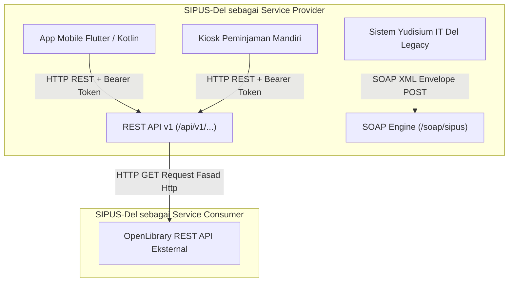
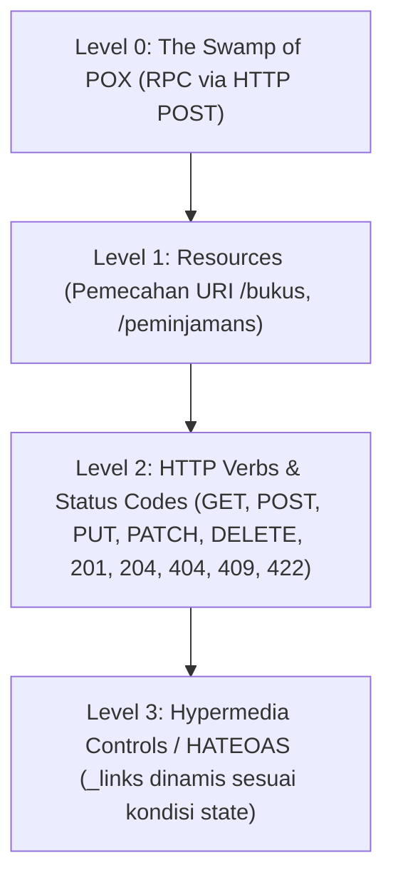
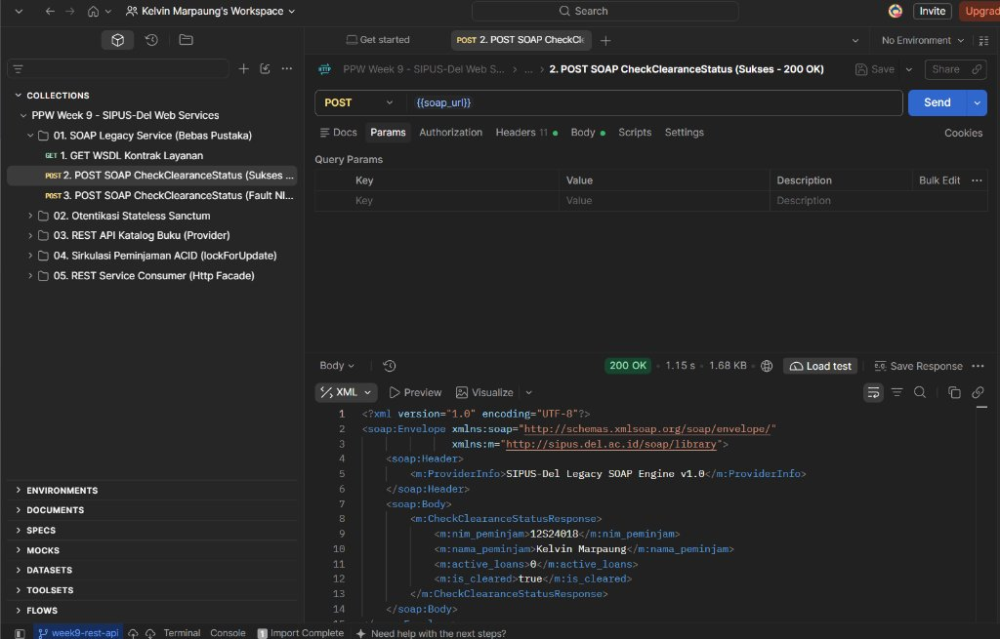
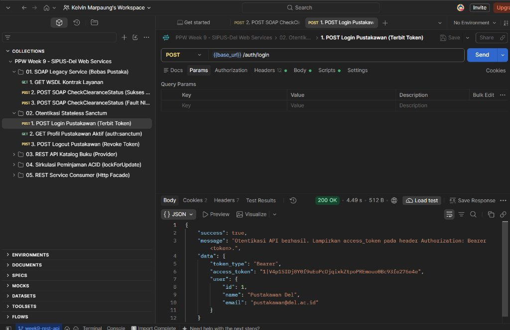
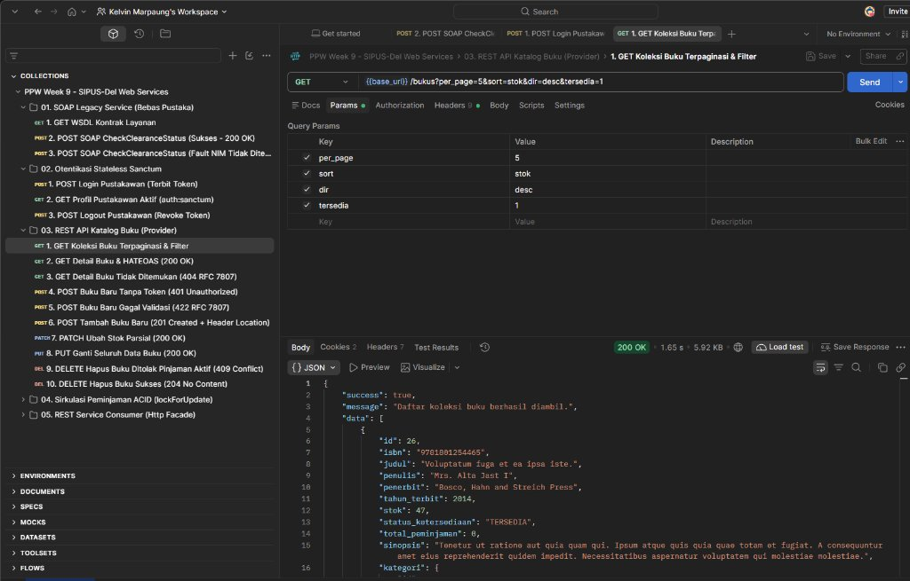
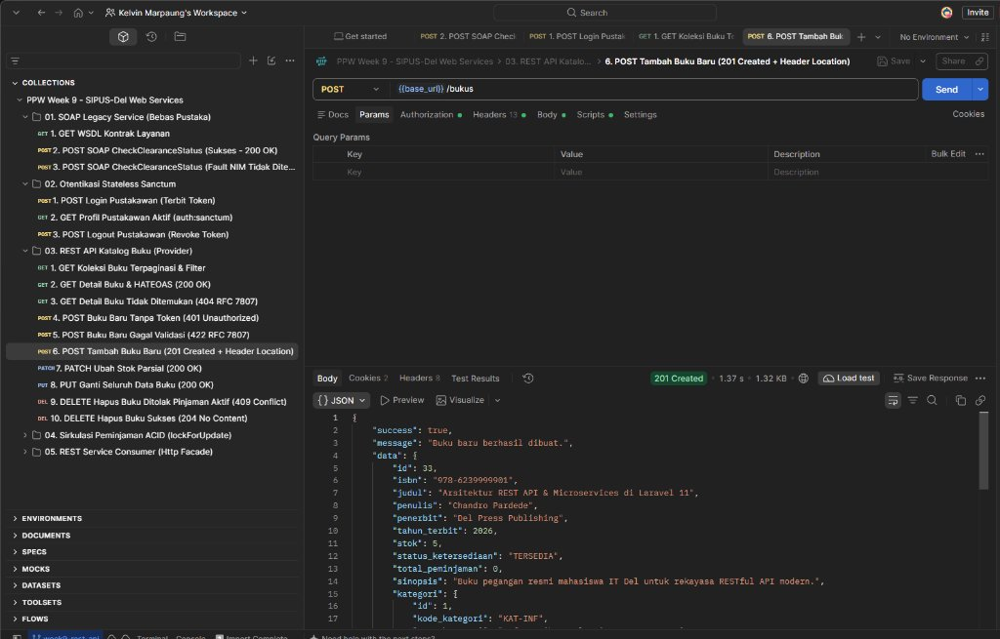
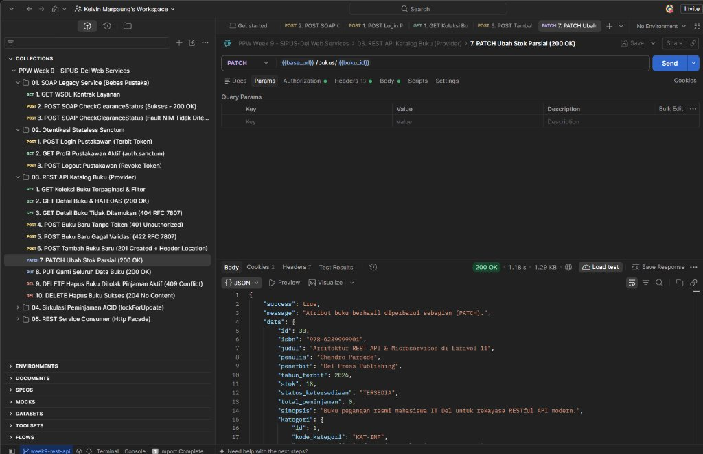
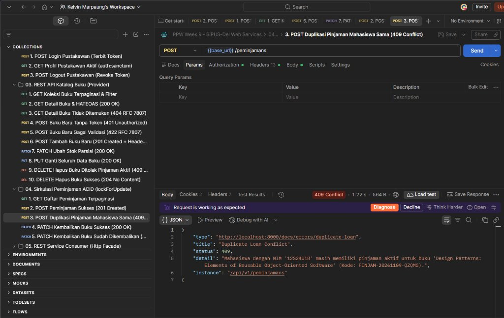
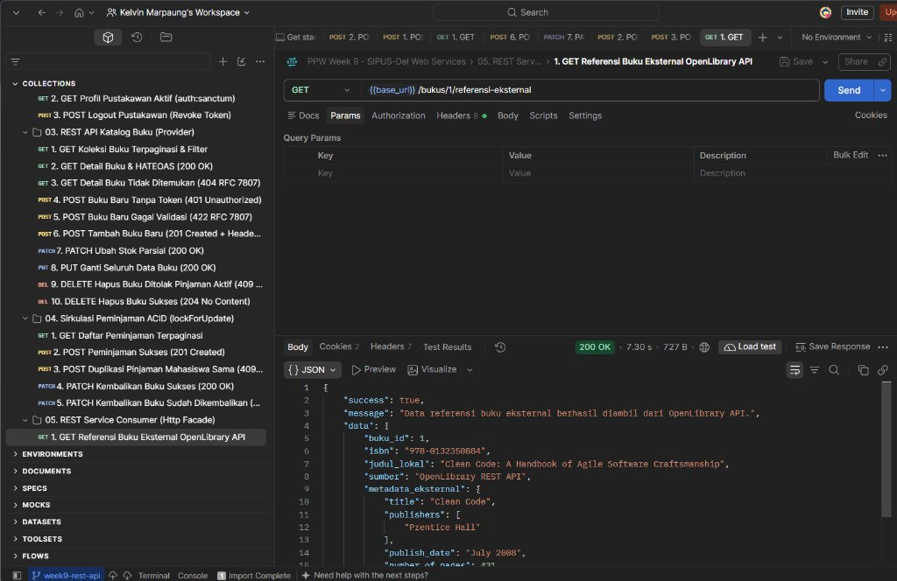

# SIPUS-Del (Sistem Informasi Perpustakaan Kampus Del) — Tahap 3: Web Services & REST API

> **Modul Praktikum Minggu 09 — Pemrograman & Pengujian Aplikasi Web (12S3101)**  
> **Program Studi Sarjana Sistem Informasi / Informatika — Fakultas Informatika dan Teknik Elektro (FITE)**  
> **Institut Teknologi Del — Semester Genap 2026/2027**

---

## 1. Identitas Mahasiswa

* **Nama:** Kelvin Yohanes Putra
* **NIM:** 12S24018
* **Program Studi:** Sistem Informasi
* **Fakultas:** Informatika dan Teknik Elektro (FITE)
* **Mata Kuliah:** Pemrograman & Pengujian Aplikasi Web (12S3101)
* **Dosen Pengampu:** Chandro Pardede, S.Kom., M.Sc.

---

## 2. Analisis Kebutuhan & Kelayakan Web Services

Pada paruh awal perkuliahan (Minggu 1 hingga Minggu 6), SIPUS-Del beroperasi sebagai sistem monolitik berbasis *Human-to-Machine* (H2M) di mana server Laravel langsung merender dokumen HTML/CSS via Blade Template Engine. 

Memasuki Minggu 9, UPT Perpustakaan Institut Teknologi Del menghadapi kebutuhan integrasi terdistribusi antar-mesin (*Machine-to-Machine* / M2M) tanpa antarmuka manusia:
1. **Layanan Bebas Pustaka Yudisium (Sistem Warisan / Legacy SOAP):** Sistem Administrasi Yudisium Kampus yang dikembangkan dengan platform enterprise lama membutuhkan verifikasi instan status tanggungan pinjaman mahasiswa (`CheckClearanceStatus`) menggunakan kontrak baku XML WSDL.
2. **Kiosk Mandiri & Aplikasi Mobile Mahasiswa (REST API Provider):** Pembacaan katalog, mutasi data buku, serta transaksi sirkulasi peminjaman/pengembalian buku harus dapat dilayani secara cepat, stateless, terenkapsulasi, dan hemat kuota bandwidth.
3. **Pengayaan Metadata Buku (REST API Consumer):** Sistem perpustakaan memanfaatkan layanan publik global **OpenLibrary REST API** untuk melengkapi informasi buku (jumlah halaman, penerbit, tahun, pranala pratinjau) berdasarkan nomor ISBN secara otomatis menggunakan fasad `Http` Laravel.

### A. Matriks Peran Layanan pada Ekosistem SIPUS-Del



| Domain Layanan | Peran SIPUS-Del | Protokol / Gaya Arsitektur | Format Payload | Skema Otentikasi | Target Konsumen |
| :--- | :--- | :--- | :--- | :--- | :--- |
| **Katalog Buku & Sirkulasi Peminjaman** | **Service Provider** | RESTful Web API (RMM Level 3 HATEOAS) | JSON (`application/json`) | Stateless Bearer Token (Sanctum) | Aplikasi Mobile Mahasiswa & Kiosk Mandiri |
| **Verifikasi Bebas Pustaka Yudisium** | **Service Provider** | SOAP 1.1 / WSDL (RPC/Literal) | XML (`<soap:Envelope>`) | None / IP Whitelist (Internal Kampus) | Sistem Administrasi Yudisium Kampus (Legacy Enterprise) |
| **Pengayaan Metadata Buku ISBN** | **Service Consumer** | REST API Consumer | JSON | Public API (No Auth) | OpenLibrary Global Book Database (`openlibrary.org`) |

---

### B. Komparasi Komprehensif: SOAP Web Service vs RESTful Web API

Mengapa arsitektur REST berbasis JSON dipilih untuk Kiosk Mandiri dan Aplikasi Mobile Mahasiswa dibanding protokol SOAP XML?

| Parameter Arsitektur | SOAP (Simple Object Access Protocol) | RESTful API (Representational State Transfer) | Alasan Pemilihan pada SIPUS-Del |
| :--- | :--- | :--- | :--- |
| **Paradigma Desain** | Protokol formal kaku berbasis kontrak XML (W3C Standard). | Gaya arsitektur (*architectural style*) yang memaksimalkan protokol HTTP/1.1 & HTTP/2. | REST jauh lebih fleksibel dan adaptif terhadap evolusi aplikasi mobile. |
| **Format Serialisasi** | Wajib XML dengan struktur baku `<soap:Envelope>`, `<soap:Header>`, `<soap:Body>`, dan `<soap:Fault>`. | Format media terbuka, standar industri adalah **JSON** (`application/json`). | JSON 5–8x lebih ringkas dan hemat bandwidth seluler dibanding XML SOAP. |
| **Pemanfaatan HTTP** | Hanya memakai metode **HTTP POST** sebagai pipa saluran (*tunneling*). Seluruh operasi dikirim ke 1 URL tunggal. | Memanfaatkan semantik alami HTTP Verbs: `GET`, `POST`, `PUT`, `PATCH`, `DELETE`. | REST mematuhi kaidah *Uniform Interface* dan *HTTP Semantics* (RMM Level 2). |
| **Kontrak Layanan** | Kontrak kaku formal berbasis file XML `.wsdl` (*Web Services Description Language*). | Spesifikasi terbuka **OpenAPI 3.0** (`openapi.yaml`) dan dokumentasi interaktif Swagger/Postman. | OpenAPI mudah dibaca manusia maupun diparsing otomatis oleh tool frontend. |
| **Kematangan Klien Mobile** | Membutuhkan XML parser berat dan *client stub generator* yang memakan CPU ponsel. | Didukung *native* oleh JavaScript, Dart (Flutter), Kotlin (Android), dan Swift (iOS). | Klien mobile dapat mem-parsing respons JSON secara instan tanpa konsumsi CPU tinggi. |
| **Manajemen State** | Seringkali stateful melalui WS-Security / WS-Addressing session headers. | **Murni Stateless (Nir-Status):** Server tidak menyimpan sesi klien. Setiap request membawa Bearer Token. | Server dapat di-scale secara horizontal di belakang Load Balancer tanpa *session stickiness*. |
| **Dukungan Caching** | Sulit di-cache oleh HTTP Proxy/CDN karena seluruh request menggunakan metode POST. | Sangat ramah *caching* (Header `Cache-Control`, `ETag`, `Last-Modified`) pada operasi `GET`. | Mengurangi beban kueri database pada katalog buku yang jarang berubah. |

---

### C. Segitiga Elemen REST & Richardson Maturity Model (RMM)

Implementasi REST API SIPUS-Del (`/api/v1/...`) dirancang memenuhi tingkat kematangan tertinggi:



1. **Level 1 (Resources / Nouns):** URI menggunakan kata benda jamak (*plural nouns*) tanpa kata kerja di URL (misal `/api/v1/bukus`, `/api/v1/peminjamans`).
2. **Level 2 (HTTP Verbs & Status Codes):**
   * `GET` (200 OK): Membaca data tanpa mutasi (*Safe & Idempotent*).
   * `POST` (201 Created + Header `Location`): Menambah data baru (*Non-Idempotent*).
   * `PUT` (200 OK): *Full Replacement* — seluruh atribut representasi wajib dikirim.
   * `PATCH` (200 OK): *Partial Update* — hanya atribut tertentu yang diperbarui (misal hanya stok).
   * `DELETE` (204 No Content / 409 Conflict): Menghapus data (*Idempotent*).
   * *Status Codes:* Menggunakan kode status HTTP yang presisi (200, 201, 204, 400, 401, 404, 409, 422, 500, 502) dan **mengharamkan anti-pattern 200 OK saat error**.
3. **Level 3 (HATEOAS — Hypermedia as the Engine of Application State):**
   Setiap respons JSON menyertakan blok `_links` yang bersifat kontekstual:
   * Pada `BukuResource`: Pranala aksi `pinjam_buku` (`POST /api/v1/peminjamans`) **hanya muncul jika `stok > 0`**. Jika stok habis, pranala tersebut otomatis hilang.
   * Pada `PeminjamanResource`: Pranala aksi `kembalikan_buku` (`PATCH /api/v1/peminjamans/{id}/kembalikan`) **hanya muncul jika status masih `'dipinjam'`**.

---

## 3. Tabel Katalog Endpoint Web Services (SOAP & REST API v1)

### A. Layanan SOAP Legacy (Bebas Pustaka Yudisium)

| No | Metode | URL Endpoint | Proteksi Auth | Deskripsi Fungsional | Status Sukses | Status Galat |
| :-: | :--- | :--- | :--- | :--- | :-: | :-: |
| 1 | `GET` | `/soap/sipus.wsdl` | Publik (None) | Menyajikan dokumen kontrak WSDL formal XML operasi `CheckClearanceStatus` | `200 OK` | `500 Internal Error` |
| 2 | `POST` | `/soap/sipus` | Publik (None) | Memproses amplop SOAP XML verifikasi bebas pustaka mahasiswa berdasarkan `<nim_peminjam>` | `200 OK` | `500 <soap:Fault>` |

---

### B. RESTful API Provider v1 (`/api/v1/...`)

| No | Metode | URI Endpoint | Proteksi Auth | Deskripsi Fungsional & Semantik | Status Sukses | Status Galat |
| :-: | :--- | :--- | :--- | :--- | :-: | :-: |
| 1 | `POST` | `/api/v1/auth/login` | Publik | Otentikasi pustakawan via JSON & penerbitan Sanctum Bearer Token | `200 OK` | `401 Unauthorized (RFC 7807)`, `422` |
| 2 | `GET` | `/api/v1/auth/me` | `auth:sanctum` | Mendapatkan profil pustakawan pemilik Bearer Token aktif | `200 OK` | `401 Unauthorized` |
| 3 | `POST` | `/api/v1/auth/logout` | `auth:sanctum` | Mencabut (*revoke*) token aktif dan mengakhiri sesi stateless | `200 OK` | `401 Unauthorized` |
| 4 | `GET` | `/api/v1/bukus` | Publik | Katalog buku terpaginasi (Filter `?kategori_id`, `?tersedia=1`, `?search`, Sort) bebas N+1 | `200 OK` | `400 Bad Request` |
| 5 | `GET` | `/api/v1/bukus/{id}` | Publik | Detail buku lengkap beserta relasi kategori, riwayat peminjaman, dan HATEOAS | `200 OK` | `404 Not Found (RFC 7807)` |
| 6 | `POST` | `/api/v1/bukus` | `auth:sanctum` | Menambah buku baru (Validasi ketat, mereturn 201 + Header `Location`) | `201 Created` | `401`, `422 Unprocessable (RFC 7807)` |
| 7 | `PUT` | `/api/v1/bukus/{id}` | `auth:sanctum` | *Full Replacement* seluruh representasi buku (field nullable direset null) | `200 OK` | `401`, `404`, `422` |
| 8 | `PATCH` | `/api/v1/bukus/{id}` | `auth:sanctum` | *Partial Update* atribut buku tertentu saja (misal hanya `{"stok": 15}`) | `200 OK` | `400 (Empty)`, `401`, `404`, `422` |
| 9 | `DELETE` | `/api/v1/bukus/{id}` | `auth:sanctum` | Menghapus buku (Ditolak jika punya pinjaman aktif, sukses tanpa body) | `204 No Content` | `401`, `404`, `409 Conflict` |
| 10 | `GET` | `/api/v1/bukus/{id}/referensi-eksternal` | Publik | **REST Consumer:** Mengambil metadata eksternal via OpenLibrary REST API | `200 OK` | `404`, `502 Bad Gateway` |
| 11 | `GET` | `/api/v1/peminjamans` | `auth:sanctum` | Daftar riwayat peminjaman terpaginasi dengan filter `?status` dan `?nim` | `200 OK` | `401 Unauthorized` |
| 12 | `GET` | `/api/v1/peminjamans/{id}` | `auth:sanctum` | Detail satu transaksi sirkulasi peminjaman | `200 OK` | `401`, `404 Not Found` |
| 13 | `POST` | `/api/v1/peminjamans` | `auth:sanctum` | **Transaksi ACID:** Pinjam buku via `lockForUpdate()`, kurangi stok (-1) | `201 Created` | `401`, `409 Conflict`, `422 Quota` |
| 14 | `PATCH` | `/api/v1/peminjamans/{id}/kembalikan` | `auth:sanctum` | **Transaksi ACID:** Kembalikan buku via `lockForUpdate()`, tambah stok (+1) | `200 OK` | `401`, `404`, `409 Conflict` |
| 15 | `DELETE` | `/api/v1/peminjamans/{id}` | `auth:sanctum` | Membatalkan transaksi peminjaman | `204 No Content` | `401`, `404 Not Found` |

---

### C. Standar Penanganan Galat Global (IETF RFC 7807 Problem Details)

Semua endpoint `/api/*` yang mengalami kegagalan dikonfigurasi melalui `bootstrap/app.php` agar secara seragam mengembalikan Content-Type `application/problem+json` dengan struktur baku:

```json
{
  "type": "http://localhost:8000/docs/errors/validation-failed",
  "title": "Unprocessable Content",
  "status": 422,
  "detail": "Satu atau lebih atribut input yang dikirim tidak memenuhi aturan validasi.",
  "instance": "/api/v1/bukus",
  "errors": {
    "isbn": [
      "The isbn field is required."
    ],
    "judul": [
      "The judul field is required."
    ]
  }
}
```

---

## 4. Panduan Instalasi & Pengujian Cepat

### A. Prasyarat Lingkungan
* PHP 8.2+ dengan ekstensi `curl`, `json`, `xml`, `simplexml`, `mbstring`, `openssl`, `pdo_mysql`, dan `pdo_sqlite`.
* Composer 2.6+
* Postman Desktop atau Bruno / Thunder Client

### B. Langkah Instalasi
1. Pindah ke branch resmi `week9-rest-api`:
   ```bash
   git checkout week9-rest-api
   ```
2. Pasang pustaka dependensi (termasuk Laravel Sanctum):
   ```bash
   composer install
   ```
3. Konfigurasi berkas `.env` dan jalankan migrasi beserta seeding data uji:
   ```bash
   php artisan migrate:fresh --seed
   ```
4. Jalankan server lokal:
   ```bash
   php artisan serve
   ```
   Server REST API & SOAP Engine akan aktif di **`http://127.0.0.1:8000`**.

### C. Kredensial Akun Uji Pustakawan (Seeder)
* **Email:** `pustakawan@del.ac.id`
* **Kata Sandi:** `password123`
* **Device Name:** `postman-desktop`

### D. Mengimpor Koleksi Postman & OpenAPI
* **Koleksi Postman:** Impor berkas `docs/SIPUS-Del-API-v1.postman_collection.json` ke Postman. Seluruh variabel lingkungan `{{base_url}}` dan auto-set bearer `{{token}}` telah terkonfigurasi otomatis via script pengujian.
* **Kontrak OpenAPI 3.0:** Buka berkas `docs/openapi-sipus-v1.yaml` di [Swagger Editor](https://editor.swagger.io/) untuk eksplorasi dokumentasi interaktif.

---

## 5. Galeri Bukti Pengujian (Screenshots Postman)

Berikut adalah galeri tangkapan layar (*screenshot*) bukti pengujian langsung melalui Postman untuk seluruh 7 skenario pengujian wajib sesuai spesifikasi modul Poin 5.3.5:

---

### Skenario A: Uji Layanan SOAP Legacy XML & `<soap:Fault>`

Pengujian endpoint SOAP `POST /soap/sipus` untuk memeriksa status bebas pustaka yudisium mahasiswa:



* **Hasil Pengujian:** Server merespons `200 OK` dengan amplop `<soap:Envelope>` yang membaca data riil mahasiswa Kelvin Marpaung (`12S24018`), mencatat jumlah pinjaman aktif `0`, dan menyatakan status bebas pustaka `<m:is_cleared>true</m:is_cleared>`. Kontrak XML WSDL formal juga dapat diakses di `GET /soap/sipus.wsdl`.

---

### Skenario B: Otentikasi Stateless Sanctum Bearer Token

Pengujian otentikasi pustakawan dan penerbitan token akses nir-status:



* **Hasil Pengujian:** Endpoint `POST /api/v1/auth/login` berhasil memverifikasi kredensial `pustakawan@del.ac.id`, mereturn status `200 OK`, dan menerbitkan Stateless Bearer Token (`access_token`). Seluruh rute mutasi API terkunci di balik proteksi `auth:sanctum`.

---

### Skenario C: GET Katalog Buku Terpaginasi & HATEOAS Level 3

Pengujian pengambilan koleksi buku dengan filter, sorting, dan navigasi hypermedia:



* **Hasil Pengujian:** Endpoint `GET /api/v1/bukus?per_page=5&sort=stok&dir=desc&tersedia=1` merespons `200 OK` dengan data terpaginasi bebas N+1 Query Problem. Setiap objek buku menyertakan kontrol hypermedia dinamis `_links` (link `pinjam_buku` otomatis aktif saat stok $> 0$).

---

### Skenario D: POST Tambah Buku Baru (201 Created + Header Location)

Pengujian penambahan buku baru ke katalog perpustakaan:



* **Hasil Pengujian:** Endpoint `POST /api/v1/bukus` berhasil menyimpan buku baru dengan validasi ketat, menghasilkan kode status semantik **`201 Created`**, dan menyertakan header **`Location: http://localhost:8000/api/v1/bukus/{id}`**.

---

### Skenario E: Bukti Nyata Perbedaan Semantik PUT vs PATCH

Pengujian modifikasi data buku secara parsial (PATCH) vs penggantian penuh (PUT):



* **Hasil Pengujian:** Endpoint `PATCH /api/v1/bukus/{id}` merespons `200 OK` dan hanya memperbarui nilai stok buku menjadi 18 tanpa menghapus atribut lain. Sedangkan pada `PUT`, seluruh atribut wajib dikirim dan atribut nullable yang tidak dikirim akan direset menjadi `null`.

---

### Skenario F: Sirkulasi Transaksi Peminjaman ACID (`lockForUpdate`)

Pengujian transaksi peminjaman buku berbasis ACID dan pencegahan duplikasi pinjaman aktif:



* **Hasil Pengujian:** Transaksi dibungkus `DB::transaction()` dan `lockForUpdate()`. Ketika mahasiswa dengan NIM `12S24018` mencoba meminjam kembali buku yang masih sedang dipinjamnya, sistem menolak seketika dengan status **`409 Conflict`** (*Duplicate Loan Conflict* RFC 7807) tanpa terjadi kebocoran stok.

---

### Skenario G: Pengayaan Metadata Buku Eksternal (REST API Consumer)

Pengujian SIPUS-Del sebagai Service Consumer yang memanggil OpenLibrary REST API:



* **Hasil Pengujian:** Endpoint `GET /api/v1/bukus/1/referensi-eksternal` berhasil memanggil API eksternal via fasad `Http::timeout(8)` Laravel dan menyajikan data nomor halaman, penerbit, serta tahun terbit buku secara otomatis dari OpenLibrary.

---

---

## 6. Disiplin Keamanan Token & Kepatuhan Git

* **Keamanan Berkas `.env`:** Berkas `.env` tidak pernah di-commit ke repositori Git. Kunci rahasia dan kredensial sensitif diabaikan melalui `.gitignore`.
* **Sensor Token Rahasia:** Seluruh token Personal Access Token (PAT) dan Sanctum Token disensor sebagian (`1|qWf...[SENSOR]...`) pada tangkapan layar dan dokumentasi.
* **Strategi Branching:** Seluruh pekerjaan diselesaikan pada branch `week9-rest-api` dengan riwayat komit berkonvensi rapi (*Conventional Commits*).

---
*Dikembangkan dengan penuh dedikasi oleh Kelvin Yohanes Putra (12S24018) untuk Praktikum Pemrograman & Pengujian Aplikasi Web (12S3101) — Institut Teknologi Del.*
